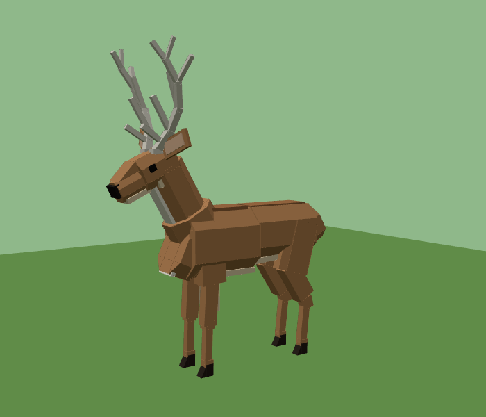

# Low-poly Deer (Roblox)

A rigged, low-poly stag for Roblox Studio. It has tan fur, a cream belly, chest and throat, a dark nose and hooves, big sideways ears, and pale five-point antlers. It is built from Blocks and WedgeParts, so there are no meshes to upload. The model is rigged but not animated.



## Getting it into Studio

Use either file:

- **`Deer.rbxmx`**: drag it into the Studio viewport, or right-click Workspace and choose *Insert from File…*.
- **`BuildDeer.lua`**: paste it into the Studio command bar and press Enter. The deer is built at the camera focus and selected.

## What's inside

```
Deer (Model, PrimaryPart = HumanoidRootPart, pivot on the ground)
├─ Humanoid (HipHeight 2.55, no name/health bar)
│  └─ Animator
├─ HumanoidRootPart (invisible, the only collider)
├─ Hips, Chest, Neck, Head, LeftEar, RightEar, Tail
├─ Left/RightFrontUpperLeg → Left/RightFrontLowerLeg → Left/RightFrontHoof
└─ Left/RightHindThigh → Left/RightHindShin → Left/RightHindCannon → Left/RightHindHoof
```

There are 21 bone parts, each joined to its parent with a **Motor6D**:

| Motor6D | Parent → Child |
|---|---|
| Root | HumanoidRootPart → Hips |
| Waist | Hips → Chest |
| NeckBase | Chest → Neck |
| Neck | Neck → Head |
| LeftEar / RightEar | Head → ears |
| Tail | Hips → Tail |
| Left/RightShoulder | Chest → FrontUpperLeg |
| Left/RightKnee | FrontUpperLeg → FrontLowerLeg |
| Left/RightFrontFetlock | FrontLowerLeg → FrontHoof |
| Left/RightHip | Hips → HindThigh |
| Left/RightStifle | HindThigh → HindShin |
| Left/RightHock | HindShin → HindCannon |
| Left/RightHindFetlock | HindCannon → HindHoof |

Each joint pivots at the real anatomical point, such as the hip, knee or hock. Each joint frame is aligned with the world axes in the rest pose, so in the Animation Editor X pitches a limb, Y yaws it and Z rolls it. The pieces that shape each bone are welded to it and nested inside it in the Explorer, so they move with the bone.

## Built to run light

- Anchored is off everywhere and the model is ready for `Humanoid:MoveTo()`. Set `HumanoidRootPart.Anchored = true` if you want a static prop.
- Only `HumanoidRootPart` has collisions. Every other part is `Massless`, `CanCollide = false` and `CanTouch = false`, except the bones, which keep touch for hit detection. Every part has `CanQuery = true`, so raycasts and arrows hit the deer.
- The bone parts hidden inside the body are fully transparent, so they cost no draw calls. Tiny details like the eyes and inner ears don't cast shadows.
- It uses SmoothPlastic and no textures: 145 parts and 21 joints.

## Changing it

The model is generated by `build_deer.py`, which needs Python 3 and numpy. Edit the shapes or colors there, then run:

```
python3 build_deer.py
```

This rewrites `Deer.rbxmx` and `BuildDeer.lua`. Run `python3 build_deer.py --json` to also write the raw part data to `deer.json`.
